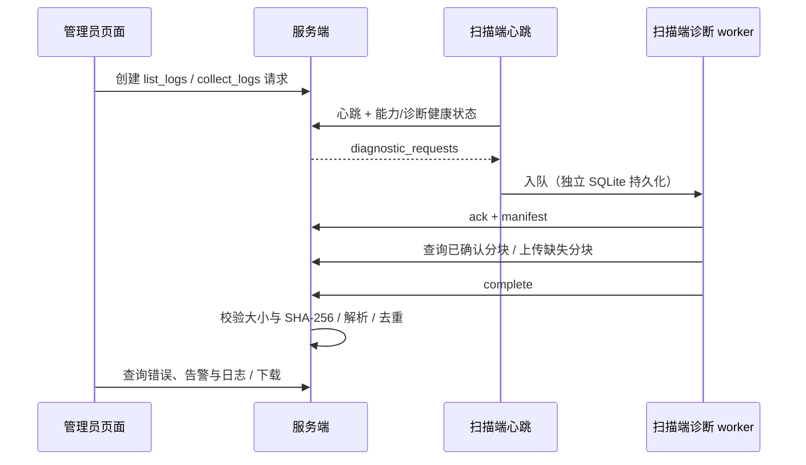

# 扫描器错误诊断与日志采集

本文描述当前实现，涉及服务端、扫描端和 Vue 管理页面。诊断协议版本为 `1`；升级顺序是服务端、扫描端、前端。它使用既有的 HTTPS、扫描器运行 Token 和心跳通道，无需 SSH，也无需开放扫描端入站端口。

## 操作流程

管理员进入扫描器详情的“错误与日志”面板，先“刷新目录”，再选择文件并“采集选中的日志”。扫描器下一次心跳收到请求，后台 worker 从启动时确定的日志目录制作不可变快照并上传。完成后可下载日志，后台自动提取错误记录并关联日志行号。

实时 WARN/ERROR 上报与日志采集使用两个独立后台任务，不在心跳续租函数内读文件、等待分块传输或解析日志。离线时显示历史错误；采集请求排队 30 分钟，恢复连接后处理，超过期限后过期。错误记录也可独立到达，无需先采集整个日志文件。



## 服务端配置与迁移

可在服务端 `config.toml` 增加以下配置；省略整个段时采用这些默认值：

```toml
[scanner_diagnostics]
enabled = true
directory = "./diagnostics"
log_retention_days = 30
error_retention_days = 90
max_storage_bytes = 10737418240 # 10 GiB，包含分块与组装空间的预留预算
# 默认需要管理员主动采集；开启后严重错误会触发目录刷新并采集最近两份日志
auto_collect = false
```

相对 `directory` 以配置文件所在目录为基准。该目录不挂载到静态资源路由，Unix 权限设为 `0700`。启动时持有 `.storage.lock` 独占锁；当前版本只支持一个服务端进程管理该目录，多个 HTTP worker 共享同一诊断状态。不能让多个服务端实例各自使用本地盘并连接同一诊断数据库；多实例部署需要共享存储、分布式文件锁和解析任务认领机制。

留存天数允许 `1..=3650`；存储预算至少 1 GiB。预算按快照声明大小预留两倍，覆盖接收分块及组装临时文件，因此实际可接收日志内容约为预算的一半；预算不足返回 HTTP 507。存储目录不能与日志目录、前端 dist 或其他业务文件目录混用。

服务端初始化事务在原有建表 SQL 后执行内嵌的
`source/database/migrate_scanner_diagnostics.sql`。它可重复执行，只增加列、表和索引，保留现有扫描器、任务和结果。新增数据：

| 数据 | 用途 |
| --- | --- |
| scanner_info 诊断列 | 能力、是否领取任务、健康状态、当前运行丢弃事件数 |
| scanner_diagnostic_job | 请求、选中文件、状态、期限、发起人、自动采集标记 |
| scanner_log_source | 最近一天的目录清单和文件身份 |
| scanner_log_file / scanner_log_upload_part | 不可变快照、校验值、分块确认、解析状态 |
| scanner_error_event / scanner_error_evidence | 去重后的事件及多个日志快照中的证据位置 |
| scanner_incident / scanner_diagnostic_recovery | 聚合告警、人工确认、恢复时间水位 |

已有扫描器默认 `accepting_tasks=true`、诊断能力为空；旧扫描端的心跳和领任务行为继续兼容。升级后的扫描端在心跳声明协议版本；新扫描端连接旧服务端时，响应缺少诊断字段默认关闭上报，保留本地诊断队列。

## 固定目录与文件语义

扫描端只读取 `--log-directory` 对应的启动时规范化目录，默认 `./logs`。API 不接受绝对路径、相对路径、命令或任意 URL，只接受此前目录清单的 `source_file_id`。只列出 `scanner.log.YYYY-MM-DD` 格式的普通文件，最多最近 128 份。Unix 使用目录文件描述符和 `openat(O_NOFOLLOW)`，拒绝软链接和非普通文件。

`source_file_id` 是文件名称、设备、inode 和可用创建时间的摘要，文件替换后原选择失效。文件正常追加不会使清单立即失效。采集时记录真实大小、修改时间、捕获时间，只复制当时已结束的完整行；没有换行的尾部字节记录为 `excluded_tail_bytes`。快照上传期间原文件追加不改变已上传内容。原文件丢失、被替换或截短时采集失败，应刷新目录后重新选择。

| 限制 | 值 |
| --- | --- |
| 每次选择 | 最多 16 个不同文件 |
| 单个文件 | 256 MiB（原文件大小检查，完整行快照不超过此值） |
| 每个采集任务 | 1 GiB |
| 分块 | 4 MiB，最后一块允许不足 4 MiB |
| 接收/组装并发 | 整个服务端最多 2 个 |
| 分块请求期限 | 60 秒 |
| 每台扫描器有效待处理任务 | 最多 4 个；每次心跳最多通知 2 个 |
| 任务期限 | 创建后 30 分钟，重试不延长 |
| 目录清单有效期 | 服务端接收后 1 天 |
| 实时事件请求体 | 最多 8 MiB，仅作用于 `POST /api/scanner/diagnostics/events` |
| 实时事件请求 | 最多 100 条，每条序列化为 JSON 后最多 64 KiB，时间不得超过服务端当前时间 5 分钟 |
| 日志解析 | 单行最多 64 KiB，超大行跳过并统计；按 100 条事件分批入库 |

普通 JSON 接口（包括扫描结果上传）继续使用 `server.max_body_size`，默认值为
`67108864` 字节（64 MiB）。实时事件接口在精确路径的 resource 上独立配置 8 MiB，
覆盖该接口的 App 级 JSON 配置；即使全局值小于 8 MiB，该接口仍采用 8 MiB。
ACK、manifest、complete 等其他诊断 JSON 接口继承全局值。请求体超过生效的 JSON
限制返回 HTTP 413，统一错误码为 `payload_too_large`；事件数量或单条大小不合法返回
HTTP 400，错误码为 `invalid_diagnostic_events`。

分块上传使用 `web::Payload` 流式读取，不受 `JsonConfig` 限制，也不会自动执行
`PayloadConfig` 的限制。服务端按 manifest 中该块的预期大小累计校验：超过预期返回
HTTP 413（`log_part_too_large`），不足预期返回 HTTP 400（`log_part_incomplete`）。
4 MiB 分块、尾块实际大小、60 秒期限以及单文件/任务上限均独立保留。

路由配置必须把事件接口的 JSON 限制放在该 resource 上，不能用 `web::scope("")`
包裹单个接口；空前缀 scope 会优先匹配后续路径，内部未匹配时走默认服务返回 404，
遮挡登录、其他 API 和前端页面。

分块大小和 SHA-256 以持久化 manifest 为准。同一分块重试且摘要相同则返回成功，摘要不同返回 409；manifest 一旦创建，文件 ID 和内容不允许变更。`complete` 要求所有分块齐全，流式组装并检查整个文件大小和 SHA-256，校验成功后才开放下载。缺块返回 409，校验不匹配将任务标记 `failed/log_checksum_mismatch` 并返回 400。

扫描端 SQLite 保留任务和 manifest；进程重启后复用原快照、文件 ID 和摘要，先查询已确认分块，再上传缺失部分。服务器重启后根据数据库与磁盘分块继续接收；确认响应丢失不会产生重复分块或重复错误记录。

## 错误识别、去重与恢复

新日志以 `fields.error_code` 优先分类。记录时间、级别、稳定错误码、分类、操作、引擎、阶段、关联 task_id、boot_id，以及退出码、耗时、结果数、无效行数等允许的标量诊断字段。旧日志没有错误码时，按 `SCAN-ERROR`、权限、磁盘满、配置和 panic 等有限规则兜底，标记 `classification_source=legacy_rule/confidence=low`；未知错误也保存，不推断未经证实的根因。

主要分类为扫描引擎、通信、认证、配置、存储、租约、部分结果、进程和未分类。`optional` 错误码归为部分结果；维护事件不计为故障。诊断不会把 WARN 改为任务失败，也不会改变原扫描结果的完成语义。

文件 formatter 为 WARN/ERROR 和恢复事件生成 UUID `event_id`，同一 ID 同时写入日志和上报队列。服务端主键为 `(scanner_id,event_id)`，重复实时上报、重复解析和交叠快照不重复增加告警次数。旧日志使用“源文件身份 + 字节偏移 + 行内容摘要”生成稳定 ID。证据表保存文件 ID、行号和字节偏移；一条事件可关联多份快照。

告警 fingerprint 根据错误码、引擎、阶段、操作计算，不含消息中的目标地址或时间。管理员可确认告警；确认表示已知悉。通信操作成功后产生 `ScannerOperationRecovered`，服务端按操作保存最大恢复时间，处理离线上报造成的乱序；恢复后发生的新错误重新打开告警。启动检查成功可结束此前启动检查失败或非正常重启告警。其他引擎错误保持待处理/已确认，不能仅凭下一次普通心跳推断已修复。

引擎启动检查失败时，扫描端保留心跳和日志采集，报告 `accepting_tasks=false`，服务端各领取任务路径不再分配新任务。修复本地配置/二进制后重启即可重新检查。无法加载配置、初始化日志、确定扫描器身份等更早的错误只能保留本地日志，不能保证远程上报。SIGKILL、OOM 或断电不保证产生最后一条错误日志；下一次运行可报告 `unclean_restart`，这只能证明未正常退出。

实时上传只发送白名单字段；扫描端和服务端对常见 password/token/secret/Authorization/Bearer 及 URL 做脱敏。原始下载文件保持快照原文，可能包含扫描目标或敏感上下文，因此仅管理员可访问。规则脱敏不是任意敏感内容识别器。

## API 契约

管理端沿用登录会话；以下接口均要求管理员 role=1，写接口仍需 CSRF。新建任务、下载和确认告警写入现有审计日志。

| 方法与路径 | 作用 |
| --- | --- |
| POST /api/scanner/{id}/diagnostic-jobs | `{ "type":"list_logs", "source_file_ids":[] }` 或 collect_logs + 清单中的 ID，成功 202 |
| GET /api/scanner/{id}/diagnostic-jobs | 最近 50 个任务 |
| GET /api/scanner/{id}/diagnostic-jobs/{job_id} | 任务详情 |
| GET /api/scanner/{id}/log-files | 可选源文件、最近 50 份快照与解析状态 |
| GET /api/scanner/{id}/log-files/{file_id}/download | ready 文件的附件下载 |
| GET /api/scanner/{id}/errors | page、level(ERROR/WARN)、error_code、task_id 过滤；每页 50，返回 has_more |
| GET /api/scanner/{id}/incidents | 最近 50 个聚合告警 |
| POST /api/scanner/{id}/incidents/{fingerprint}/ack | 人工确认 |

机器接口沿用 `Authorization: Bearer <runtime_token>`，绑定请求中的 scanner_id 并验证启用状态。只有以下精确路径/方法可绕过浏览器会话和 CSRF；不使用路径前缀豁免。它们使用独立的每 Token 每分钟 120 次限流桶，避免占用心跳限额。

| 方法与路径（前缀 /api/scanner/diagnostics） | 请求/响应关键字段 |
| --- | --- |
| POST /ack | scanner_id、job_id、status=accepted/failed、可选 error_code |
| POST /manifest | scanner_id、job_id、sources[]、files[]；文件含 source、file_id、size_bytes、excluded_tail_bytes、captured_at、sha256 |
| GET /upload-status | query scanner_id、job_id、file_id；返回 parts[] |
| PUT /chunk | 上述 query + part_index；application/octet-stream 原始分块 |
| POST /complete | scanner_id、job_id |
| POST /events | scanner_id、events[]；成功返回 confirmed[]，扫描端只删除确认 ID |

所有任务和文件查询检查 scanner_id 归属。下载文件路径由数据库 UUID 生成，不拼接客户端文件名。机器 Token 不允许访问管理端目录、错误查询或下载。

心跳请求附加 `diagnostics={supported_versions:[1],can_list_logs:true,can_collect_logs:true,can_report_errors:true}` 和 `diagnostic_health={accepting_tasks,status,dropped_events}`；响应附加 `diagnostics_enabled` 与 `diagnostic_requests[]`。通知包含 job_id、type、protocol_version、source_file_ids、expires_at。

## 后台维护和运维

后台每 5 秒检查任务期限并处理两份待解析日志。解析失败每 30 秒重试，最多 5 次；最终失败的原始日志仍可下载，页面显示“分析失败”。重复解析的事件去重保证安全。每约 5 分钟清理到期文件、失败/过期任务的未完成上传、旧事件/告警/恢复时间水位、过期目录清单；只清理 UUID 命名、超过 1 小时的孤立临时文件。

`auto_collect=true` 时，只对最近 5 分钟内 ERROR 的扫描引擎、配置、存储、进程、认证分类触发，单扫描器自动请求冷却 30 分钟；先列目录，再采集最近两份日志。每日文件超过单文件限制仍会失败。全量维护期间暂停诊断机器请求和后台处理；暂停新任务的维护模式不向心跳下发新采集请求。队列和快照保留，期限仍按原创建时间计算。

常见失败码：`log_catalog_stale`（刷新目录）、`log_file_changed`（文件替换/截短）、`log_file_too_large`（缩小日志文件后重新采集）、`log_collection_failed`（检查扫描端本地诊断日志与磁盘权限）、`diagnostic_job_expired`、`log_checksum_mismatch`、`log_parse_failed`。遇到 401 应恢复扫描器身份，不能用重试隐藏失效 Token。

告警在本功能中体现为页面聚合、人工确认和恢复状态；现有扫描器离线邮件流程保持原实现。本次没有新增错误邮件/Webhook、全文搜索、日志压缩或独立分布式诊断服务。

## 实现位置与验证

- `src/scanner_diagnostics/{protocol,parser,mod,tests}.rs`：协议、归一化、持久化、后台解析与留存。
- `src/handlers/scanner_diagnostics.rs`：权限、任务和分块/下载 API。
- `src/handlers/task.rs`、`src/lib.rs`：心跳能力协商、健康状态和任务分配门禁。
- 扫描端 `src/diagnostics/`、`src/logging.rs`：固定目录快照、独立 SQLite、事件捕获和上传。
- 前端 `src/components/ScannerDiagnostics.vue`：扫描器详情诊断面板。

常规检查：

```sh
cargo fmt --check
cargo clippy --all-targets
cargo test
```

登录/API/前端路由以及 JSON 大小限制的回归测试不需要数据库：

```sh
cargo test handlers::scanner_diagnostics::tests
```

这组测试使用实际应用路由检查登录请求能进入 JSON 提取器、版本接口和前端页面可访问、
事件接口只接受 POST，并在生产事件 resource 上附加测试专用提取器检查 8 MiB 边界、
全局 64 MiB 边界和自定义小限额互不干扰，以及 413 的统一错误格式。

数据库专项测试默认 ignored，需要独立、可丢弃的 PostgreSQL 数据库，库名必须包含 `nm_diagnostics_test`。它执行实际迁移两次，使用测试 scanner/token，测试结束后可销毁该数据库；不可指向部署数据库。

```sh
NM_DIAGNOSTICS_TEST_DATABASE_URL='host=<test-host> dbname=nm_diagnostics_test user=<test-user>' \
  cargo test authenticated_transfer_deduplicates_errors_and_checks_ownership -- --ignored --nocapture
```

专项测试覆盖实时重复 ACK、真实事件 POST 的 8 MiB 请求体边界、超过 100 条或单条超过 64 KiB 的事件拒绝、跨 4 MiB 分块及续传状态、超大分块、过长/不足的尾块、缺块、重复/冲突分块、大小/SHA 校验、错误解析/证据去重、损坏/超大行、脱敏、CSRF、非管理员拒绝、扫描器归属隔离、下载和恢复事件乱序。真实多台扫描器长期运行的压力测试、跨实例共享存储和外部错误通知需另行验证或实现。

### 本次验证记录（2026-10-01）

- 两端 `cargo fmt --check`、`cargo clippy --all-targets` 通过，无新增警告。
- 服务端常规测试 314 项通过；默认忽略的 40 项中，诊断专项在独立 PostgreSQL 18 数据库另行执行并通过，其余外部基础设施集成测试未运行。
- 扫描端 121 项测试通过，含诊断任务/manifest 重启恢复和到期清理。
- 前端 `pnpm build` 通过；本地 Chrome 使用模拟 API 验证桌面、390px 手机、目录刷新、选择采集、证据下载、告警确认、离线、启动异常、旧能力、空状态、服务错误及 403，无页面异常和整体横向溢出。
- 未执行真实生产部署、长期多节点压力测试或断电持久化测试。

### 登录路由修复验证（2026-10-01）

- 将事件接口的 8 MiB JSON 限制移至精确路径 resource，移除遮挡后续路由的空前缀 scope；全局 JSON 配置、事件业务限制和流式分块限制保持原值。
- 服务端 `cargo fmt --check`、`cargo clippy --all-targets` 通过，无警告；`cargo test` 共 316 项通过、40 项按原设置忽略。
- 诊断专项测试在独立 PostgreSQL 18 测试库中另行执行并通过，包含新增的真实 POST 请求体边界、事件业务限制和尾块大小检查；其余 39 项默认忽略测试未在本次修复中另行执行。
- 登录路由通过无数据库的非法 JSON 请求验证可达性；未运行需要配置数据库和预置管理员的真实账号登录测试，也未执行生产部署。
